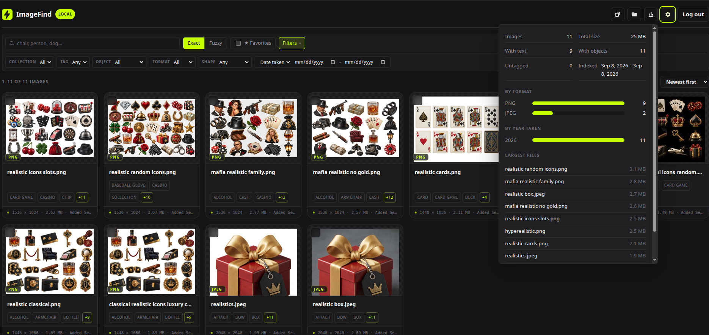
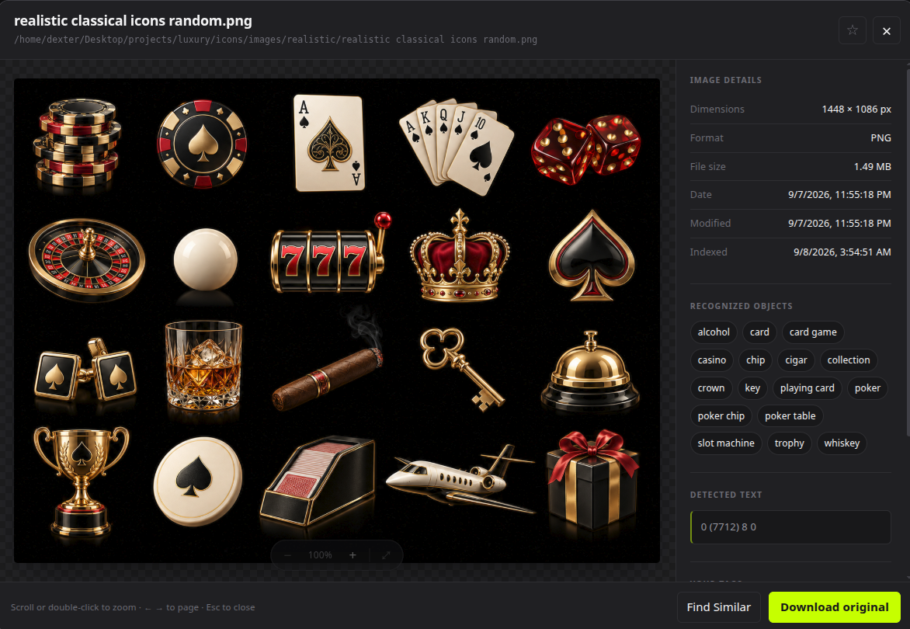
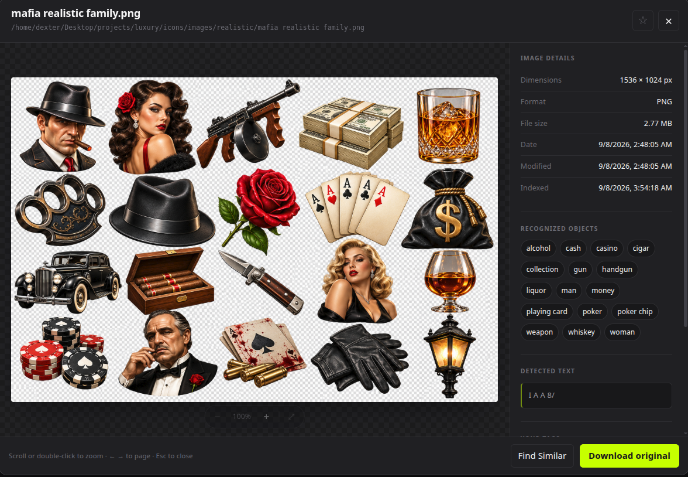

# ImageFind — Search Your Image Library


Search a local folder or NAS by what an image shows, what it says, or where
it lives. ImageFind reads text with OCR, recognizes objects, and finds visually
similar images. It keeps your originals in place and builds a local catalog
with metadata, embeddings, and thumbnails.

[Quick start](#quick-start) · [Screenshots](#screenshots) ·
[User guide](docs/GUIDE.md) · [Running and commands](docs/RUNNING.md)



## Features

- **Search by text or meaning.** Exact search covers filenames, paths, OCR,
  and tags. Fuzzy search ranks images by how closely they match a description.
- **Find and label objects.** Locate recognized objects in the detail view or
  draw a box to teach ImageFind a custom tag from a crop.
- **Browse and organize.** Filter by object, date, format, and orientation.
  Star favorites, add notes and tags, and group images into collections.
- **Find related images.** Open an image to find similar results or scan the
  library for near-duplicates.
- **Share and export.** Share a filtered view by URL, export results to CSV
  or JSON, or download selected originals as a ZIP.
- **Keep the catalog current.** Folder watching picks up file changes, and
  periodic scans catch missed NAS events. Indexing continues in the background
  and supports on-demand SQLite backups.

Supported image formats: PNG, JPG/JPEG, WebP, BMP, GIF, TIFF, AVIF (HEIC/HEIF
too if the optional `pillow-heif` package is installed). For multi-frame GIF or
AVIF only the first frame is indexed. RAW, PSD, and SVG are not supported.

## Quick start

### Requirements

- Python 3.10 or newer
- Node.js 20.19+ on the 20.x line, or 22.12+
- Enough disk space for the local SQLite index and thumbnails
- Read access to the image folder or mapped NAS drive
- Optional: NVIDIA GPU for much faster initial indexing

### Install and run

Clone or download the project and run these commands from its root directory.

```powershell
npm ci
npm --prefix frontend ci
npm run setup:backend
npm run auth:set-password
npm start
```

To install CUDA-enabled PyTorch for an NVIDIA GPU, use this backend setup command.

```powershell
npm run setup:backend -- --cuda
```

Open <http://localhost:5175> and sign in with the shared password. In
**Settings**, enter your image folder, install the RAM++ model, then select
**Save & Reindex**.

### Other ways to run

Run this command to start the app with a public Cloudflare quick tunnel.

```powershell
npm run start:tunnel
```

Open:

- ImageFind (frontend and API): <http://localhost:5175>
- API documentation: <http://localhost:5175/docs>
- Public tunnel (`start:tunnel` only): use the temporary `trycloudflare.com`
  URL printed in the `[tunnel] Ready:` block once the backend is up

Both commands first create an optimized React production build, then start the
single localhost-only FastAPI server; Vite is never exposed. `npm run
start:tunnel` additionally runs a Cloudflare quick tunnel, started only after
the backend is accepting connections, and prints a fresh temporary public URL
each run. Press `Ctrl+C` once to stop everything.

For frontend development only, run `npm run start:frontend`; that starts Vite
on port 5173 and proxies `/api` to the local backend.

## Screenshots

The library grid above combines thumbnails, filters, and index statistics.
The detail view shows recognized objects and detected text alongside the
full-size image.

| Object tags on a casino icon sheet | Object tags on a themed illustration |
| --- | --- |
|  |  |

## Authentication

ImageFind uses a shared account with a password of at least 12 characters.
Each browser receives its own seven-day, revocable session after sign-in.

- Passwords are hashed with Argon2id through `pwdlib`; plaintext is never
  persisted or logged.
- Browser cookies contain a random opaque token, not the password or user
  data. Only the token's SHA-256 digest is stored in SQLite.
- Session cookies are `HttpOnly`, `SameSite=Strict`, and `Secure` over the
  HTTPS tunnel.
- All data-bearing API routes require a valid session.
- State-changing requests require a session-bound CSRF token.
- Login attempts have both per-IP and global server-side limits, plus a cap on
  concurrent Argon2 work. Search and original-image downloads have independent
  per-session limits.
- Settings, reindexing, and model installation/status are rejected through the
  public tunnel even after login. They are available only from the local app.
- The production server applies CSP, HSTS on HTTPS, anti-framing, MIME-sniffing,
  referrer, and browser permission headers.

Local account management commands:

```powershell
npm run auth:status
npm run auth:set-password
npm run auth:revoke-sessions
```

If no password is configured, ImageFind fails closed: the login page displays
local setup instructions and protected API routes remain inaccessible.

## Indexing

The first run can take a long time for hundreds of thousands of images. The
index is saved regularly. A progress bar at the top of the page shows how far
along it is; indexing happens on the server, so closing the tab (or reopening
it later) doesn't interrupt it — the bar reattaches to the run still going.
Hiding the bar with **×** only hides it. Only **Stop** cancels the run, and
already completed images are kept; starting a normal **Reindex** later skips
unchanged completed files.

Files that can't be processed (corrupt, removed mid-scan, or inside an
unreadable subfolder) don't stop the run: everything reachable is still
indexed, and the reindex status reports the failure count plus the first
100 failing paths. An incomplete folder scan never prunes existing entries.

Changing model or tagging settings with **Save & Reindex** intentionally forces
all images to be processed again.

The RAM++ download is pinned to its immutable publisher revision and expected
size. Its SHA-256
`497c178836ba66698ca226c7895317e6e800034be986452dbd2593298d50e87d`
is checked before installation and again before the PyTorch checkpoint is
loaded. A partial or mismatched file is deleted instead of being installed.

## Automatic folder updates

The realtime watcher is enabled by default:

- New image: index it.
- Changed image: update its metadata and embedding.
- Moved or renamed image: remove the old path and index the new path.
- Deleted image or folder: remove its database row and cached thumbnail.

A full reconciliation scan runs every four hours by default to catch changes
missed by NAS/SMB notifications. It processes only new or changed files.
Scheduled reconciliation confirms a missing path in two consecutive scans
before deleting it, protecting the index during a temporary NAS interruption.

## Searching

The main search box searches all of these fields together:

- Filename and extension
- Full folder path
- OCR text
- RAM++ objects
- Custom tags

A multi-word query is split into terms and **AND-ed** across the searchable
fields. Queries with no term of at least three characters fall back to a plain
substring scan. When the sort is left on its default, text results are ordered by
relevance (bm25), with whole-word matches floated above matches that only occur
inside a longer word.

A **★ Favorites** toggle sits next to the search box, and **More filters**
expands the rest: exact object tag, format, orientation (landscape / portrait /
square), a from/to date range against one of date added (default), file mtime, capture
date, or index time, collection, and your own tags. Every filter is optional.
Results must satisfy all active filters and the text query.

**Exact / Fuzzy** by the search box switches the engine. **Exact** (the default)
is the literal trigram/tag search above. **Fuzzy** embeds your words with SigLIP 2
and returns the images whose visual meaning is closest; it needs query text,
ignores the other filters and pagination, and can be confidently wrong — use it
to cast a wide net, then narrow with Exact.

**Find Similar** is related: it uses a selected image's embedding rather
than typed text to find visually related images. It is a transient view and,
unlike a normal search, does not change the URL.

Search input is debounced and stale browser requests are cancelled. The API
also validates lengths and control characters, uses parameterized SQLite
queries, treats FTS special characters literally, and limits each client to 30
search requests per 10 seconds.

## Organizing your library

Favorites, tags, notes, and collections are *your* curation on top of what the
models detected. They are stored in the index next to each image, **survive a
reindex** (an image keeps its id), and — since ImageFind is a single-account
app — are shared by everyone who opens it.

- **Favorite** — the ★ on a card, a table row, or the detail view. Filter with
  the **★ Favorites** toggle.
- **Your tags** — free-text tags added in the detail view, kept separate from
  RAM++ object tags so a reindex never overwrites them. Filter with **Your tag**.
- **Note** — a free-text note per image, in the detail view, saved on blur.
- **Collections** — named sets of images. The folder button in the header
  creates, renames, and deletes them; "Add to collection…" in the detail view
  files the open image. Filter with **Collection**. Deleting a collection never
  touches the images.

Tick the checkbox on any card or row to select images. While a selection is
active a bulk bar offers: favorite / unfavorite, add comma-separated tags (kept
additive), add to a collection, **Download .zip** of the originals (max 500;
vanished files skipped), and Clear. The selection resets on a new search or
Find Similar.

## Duplicates, stats, backups, and export

- **Duplicate finder** (overlapping-squares button) scans the first ~5,000
  images and clusters ones that are visually near-identical (cosine
  distance ≤ 0.035 — resizes, re-exports, near-crops). ImageFind never deletes
  files; it just shows you what to clean up on disk.
- **Library stats** (bar-chart button) reads straight from the index: total
  images and disk size, indexed-date range, counts by format and by year taken,
  how many images have OCR text / objects / neither, and the ten largest files.
- **Export → CSV / JSON** (next to the view toggle) downloads the entire current
  result set — not just the visible page — with every filter and sort applied.
  Columns include path, filename, format, dimensions, size, ISO-8601 UTC dates,
  objects, your tags, favorite flag, note, and OCR text. Capped at 50,000 rows.
- **Index backups** — **Settings → Index backups → Back up now** writes a
  consistent standalone copy to `backend/.index/backups/index-<timestamp>.db`
  (ten most recent kept) without blocking searches. To restore: stop the server,
  replace `backend/.index/index.db` with a backup, delete any `index.db-wal` /
  `index.db-shm` beside it, and start again. Local-only, not available through
  the tunnel.

## Models and tools

| Component | Purpose |
|---|---|
| RAM++ with Swin-L | Automatic object and scene tags (near-universal tags such as `photo` and `white background` are dropped; see `RAM_TAG_DENYLIST`) |
| SigLIP 2 ViT-B/16 (`webli`, via OpenCLIP) | 768-dimensional image embeddings for Find Similar, Fuzzy text search, the duplicate finder, and custom-tag matching |
| EasyOCR | Text extraction from image pixels |
| SQLite FTS5 (trigram) | Filename, path, OCR, and tag text search, with bm25 relevance ranking |
| sqlite-vec | Cosine nearest-neighbor search over the image embeddings |
| Watchdog | Realtime local/NAS filesystem events |

Each image is decoded once and read by every stage; EXIF orientation is applied
so rotated photos are catalogued the way they display.

The RAM++ checkpoint is downloaded from Hugging Face by the Settings panel and
stored at `backend/pretrained/ram_plus_swin_large_14m.pth`. SigLIP 2 (~1.5 GB) and EasyOCR
download their required model files on first use.

## Local data

Generated data is stored under `backend/.index/`:

- `index.db` — SQLite catalog, FTS rows, vector embeddings, and your curation
  (favorites, tags, notes, collections)
- `thumbnails/` — generated preview images
- `backups/` — on-demand `index-<timestamp>.db` snapshots (ten most recent kept)
- `settings.json` — selected folder and RAM++ settings
- `auth.db` — Argon2id credential metadata and hashed, revocable sessions

This directory is ignored by Git. Back it up if preserving a completed index is
important; it can also be regenerated from the original images.

## Useful environment variables

| Variable | Default | Purpose |
|---|---|---|
| `IMAGES_DIR` | `./images` | Initial image folder before a saved Settings value exists |
| `INDEX_DIR` | `./.index` | Index and thumbnail directory, relative to `backend/` |
| `ENABLE_WATCHER` | `true` | Enable realtime filesystem monitoring |
| `RECONCILE_INTERVAL_SECONDS` | `14400` | Scheduled reconciliation interval |
| `MTIME_TOLERANCE_SECONDS` | `2.0` | Modification-time drift ignored when deciding a file is unchanged (guards against NAS clocks that round timestamps) |
| `RAM_CHECKPOINT_PATH` | `pretrained/ram_plus_swin_large_14m.pth` | RAM++ checkpoint location |
| `RAM_TAG_DENYLIST` | ~40 generic tags | Comma-separated RAM++ tags dropped from every image (`photo`, `illustration`, `white background`, …); set to empty to keep all tags |
| `CORS_ALLOWED_ORIGINS` | empty | Optional comma-separated additional browser origins |
| `SEARCH_RATE_LIMIT_REQUESTS` | `30` | Search requests allowed per client/window |
| `SEARCH_RATE_LIMIT_WINDOW_SECONDS` | `10` | Search rate-limit window |
| `AUTH_SESSION_TTL_SECONDS` | `604800` | Browser session lifetime (seven days) |
| `AUTH_MAX_SESSIONS` | `50` | Maximum simultaneous browser sessions |
| `AUTH_LOGIN_RATE_LIMIT_REQUESTS` | `20` | Login attempts allowed per client/window |
| `AUTH_LOGIN_RATE_LIMIT_WINDOW_SECONDS` | `300` | Login rate-limit window |
| `AUTH_GLOBAL_LOGIN_RATE_LIMIT_REQUESTS` | `100` | Login attempts allowed across all clients/window |
| `AUTH_GLOBAL_LOGIN_RATE_LIMIT_WINDOW_SECONDS` | `300` | Global login rate-limit window |
| `AUTH_MAX_CONCURRENT_LOGINS` | `4` | Maximum simultaneous password verifications |
| `DOWNLOAD_RATE_LIMIT_REQUESTS` | `60` | Original downloads allowed per session/window |
| `DOWNLOAD_RATE_LIMIT_WINDOW_SECONDS` | `60` | Download rate-limit window |
| `VITE_API_BASE_URL` | `/api` in development, same origin in production | Backend URL used by the frontend |

## Frontend checks

```powershell
npm --prefix frontend run lint
npm run build:frontend
```

## Remote access

FastAPI serves the production frontend and API on one origin. The tunnel points
to `127.0.0.1:5175`, while Uvicorn remains bound to localhost and runs without
auto-reload. Share only the generated tunnel URL; do not bind port 5175 to the
LAN or internet. Quick tunnels are temporary infrastructure and do not provide
an uptime guarantee.
